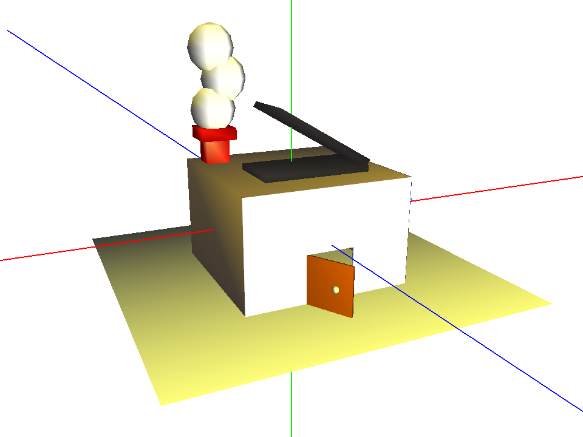

# Modern House · OpenGL

An interactive 3D scene in C++ and legacy OpenGL: an articulated, animated hierarchical model of a modern house, with flat and Gouraud lighting, a texture-mapped cube and several camera views.




## Features

- **Hierarchical, articulated model**: a house built from a scene graph of transformed primitives (facade, chimney, solar panel, door, door knob, window). Four joints move independently: the door, the knob (a child of the door, so it moves with it), the window and the solar panel, each with its own limits.
- **Animation**: a sequence that opens the door, turns the knob, opens the window and raises the solar panel.
- **Lighting and materials**: flat and smooth (Gouraud) shading with face and vertex normals, two light sources (one of them can be rotated) and per-part material coefficients.
- **Geometry**: procedural primitives (cube, pyramid, cylinder, cone, sphere), surfaces of revolution, extrusion and triangle meshes loaded from PLY files.
- **Texturing and cameras**: a cube mapped with a sky texture, a perspective camera you can orbit with the mouse or keyboard, and a four-view orthographic layout.
- **Colour picking**: left-click a part of the house to toggle it to wireframe, using an off-screen colour-ID pass. An on-screen legend (toggle with `H`) lists every control.

## Tech stack

| Technology | Used for |
|---|---|
| C++ | Application, geometry classes and scene graph |
| OpenGL 1.x (fixed pipeline) | Rendering, lighting, materials, texturing, colour picking |
| GLUT (Apple GLUT / freeglut) | Window, input events, idle-loop animation, bitmap text |
| [CImg](https://cimg.eu) + libjpeg | Loading the JPEG texture |
| Make | Build, with separate macOS and Linux settings |
| Swift (tooling only) | `tools/genera_skybox.swift` generates the sky texture procedurally |

## Getting started

### Requirements

- **macOS**: Xcode Command Line Tools and Homebrew. OpenGL and GLUT ship with macOS (deprecated by Apple, but still working).
- **Linux**: `g++`, `make`, freeglut, GLU and libjpeg (on Debian/Ubuntu: `sudo apt install build-essential freeglut3-dev libglu1-mesa-dev libjpeg-dev`).

### Build and run (macOS)

```bash
xcode-select --install
brew install jpeg-turbo
make
```

`make` compiles the project and launches it as `./practica_objetos_B3 beethoven peonza` (the two arguments are PLY models loaded at start-up). `make clean` removes build files.

The steps above were tested on macOS 27 (Apple Silicon). The Linux settings in the `makefile` follow the original course setup but were not re-tested after the macOS port.

### Controls

Press **`A`** to show the house, **`6`** for smooth lighting and **`S`** to start the animation. The full list is also shown inside the window.

| Keys | Action |
|---|---|
| `A` · `B` | Modern house · textured cube |
| `O` · `Z` | PLY model · PLY surface of revolution |
| `C` `V` `P` `M` `R` `L` `N` `E` `X` | Cube, transformed cube, pyramid, wedge, revolution, cylinder, cone, sphere, extrusion |
| `1`–`4` | Points · edges · solid · random colours |
| `5` · `6` | Flat lighting · smooth (Gouraud) lighting |
| `S` | Start/stop the animation |
| `F1`/`F2` · `F3`/`F4` | Open/close the door · open/close the window |
| `F5`/`F6` · `F7`/`F8` | Raise/lower the solar panel · turn the knob |
| `F9` | Rotate one of the lights |
| Arrow keys · `PgUp`/`PgDn` | Orbit the camera · zoom |
| `,` · `.` | Single perspective view · four orthographic views |
| Right-drag · left-click | Orbit the camera · toggle a house part to wireframe |
| `H` · `Q` | Show/hide the legend · quit |

On a Mac keyboard, function keys need `fn` (for example `fn`+`F1`) and `PgUp`/`PgDn` are `fn`+`↑`/`↓`.

**Known limitations on macOS:** Apple's GLUT does not report mouse-wheel events, so wheel zoom in the four-view layout does not work there. Colour picking (left-click) has not been verified on macOS.

## Project structure

```
.
├── practica_objetos_B3.cc   # main: GLUT setup, input, cameras, lights, texture, legend
├── objetos_B3.h / .cc       # geometry classes, lighting modes and the modern-house model
├── file_ply_stl.hpp / .cc   # PLY reader (third-party, GPL)
├── vertex.h                 # vector/matrix types (third-party, GPL-3.0)
├── CImg.h                   # image loading library (third-party, CeCILL)
├── beethoven.ply, peonza.ply
├── skybox.jpg               # sky texture, generated by tools/genera_skybox.swift
├── tools/
│   └── genera_skybox.swift  # procedural sky generator
├── GRAFO/                   # scene-graph design document (PDF) and step-by-step screenshots
├── makefile
└── LICENSE
```

## What I learned

- **Designing a scene graph before coding it.** I sketched the house as a tree of transforms (see `GRAFO/GRAFO_P3.pdf`), which made the order of `glPushMatrix`/`glRotatef`/`glTranslatef` calls, and joints such as the knob riding on the door, straightforward to implement.
- **How lighting depends on normals.** Implementing face and vertex normals made the difference between flat and Gouraud shading concrete, and showed how material coefficients change the look of each part.
- **Picking with an off-screen colour pass.** Rendering every part with a unique ID colour into the back buffer and reading back one pixel is a simple, robust alternative to ray casting.
- **Porting legacy code.** Getting the project to build on macOS meant handling platform headers, framework linking and a JPEG dependency with minimal changes to the original code.

## Context & credits

This was my coursework for **Informática Gráfica** (Computer Graphics) at the **University of Granada (UGR)**, in 2023. It builds on the skeleton code that the course provided, which I extended over several practicals.

**My work:** the whole modern-house model and its scene graph, joints and animation, the lighting and materials setup, the textured cube, the multi-view camera and colour picking for the house parts, plus my extensions to the base geometry classes across the practicals. In 2026 I also added the macOS build, the on-screen legend and the procedural sky texture.

**Third-party code and assets:**

- `vertex.h`: Domingo Martín Perandres (UGR), GPL-3.0.
- `file_ply_stl.hpp` / `file_ply_stl.cc`: Domingo Martín and Carlos Ureña (UGR), GPL.
- `CImg.h`: [The CImg Library](https://cimg.eu) by David Tschumperlé, CeCILL-C / CeCILL.
- Course skeleton for `practica_objetos_B3.cc` and `objetos_B3.*`: Informática Gráfica teaching staff, UGR.
- `beethoven.ply`: sample model distributed with the course material.

Because it includes GPL code, this project is released under the [GNU GPL v3.0](LICENSE).
